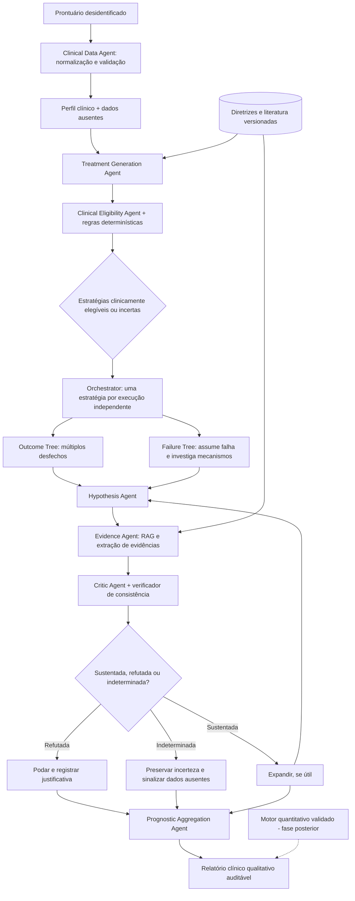

# Sistema multiagente para geração de cenários prognósticos em câncer de tireoide

**Versão:** 1.0 — 23/10/2026  
**Natureza:** proposta de pesquisa e implementação; não é dispositivo médico validado nem recomendação de tratamento.

## 1. Objetivo

Dado um prontuário desidentificado de um paciente com câncer de tireoide, o sistema deverá:

1. Construir um perfil clínico estruturado, identificando informações ausentes.
2. Gerar dinamicamente estratégias de tratamento plausíveis, segundo subtipo tumoral, estágio, contexto clínico, tratamentos prévios e diretrizes versionadas.
3. Verificar elegibilidade, restrições e contraindicações, preservando incertezas.
4. Construir, **independentemente para cada estratégia**, uma árvore de cenários de evolução clínica (*Outcome Tree*) e outra árvore de mecanismos de falha (*Failure Tree*).
5. Gerar hipóteses, recuperar evidências, avaliar mecanismos causais plausíveis, expandir ou podar nós refutados, registrando todas as decisões.
6. Produzir relatório de **cenários prognósticos qualitativos**, com trilha de auditoria. Em fase posterior, incluir estimativas quantitativas a partir de modelos treinados e validados em dados longitudinais.

**Distinção essencial:** hipóteses geradas por LLMs não equivalem a riscos prognósticos medidos. A ausência de uma explicação de falha na árvore tampouco implica eficácia ou segurança do tratamento.

## 2. Escopo clínico e fontes

Iniciar por **carcinoma diferenciado de tireoide** (papilífero e folicular), com extensão posterior para carcinoma medular e anaplásico. As estratégias elegíveis variam segundo histologia, estadiamento, extensão, características moleculares, função orgânica, performance status e preferências do paciente.

Tratamentos a representar no catálogo: vigilância ativa selecionada; lobectomia ou tireoidectomia e outras intervenções cirúrgicas apropriadas; iodo radioativo (I-131), quando indicado; radioterapia externa em circunstâncias selecionadas; terapia-alvo; tratamento sistêmico incluindo quimioterapia citotóxica e imunoterapia apenas onde apropriado; cuidados de suporte e paliativos; e **sequências** de intervenções quando indicadas. Não oferecer iodo radioativo para câncer medular/anaplásico como tratamento dirigido ao tumor.

As regras e evidências devem ser versionadas. Nenhuma diretriz substitui avaliação da equipe médica.

## 3. Arquitetura



### 3.1. Responsabilidades

| Componente | Entrada | Saída |
|---|---|---|
| Clinical Data Agent | Prontuário | Perfil estruturado com evidência da origem de cada campo |
| Treatment Agent | Perfil + catálogo/diretrizes | Estratégias candidatas, inclusive sequenciais |
| Eligibility Agent | Estratégia + dados clínicos | Elegível / não elegível / incerto e justificativas |
| Hypothesis Agent | Nó corrente + tratamento + paciente | Novas hipóteses estruturadas de evolução ou falha |
| Evidence Agent | Hipótese | Passagens citáveis de documentos, qualidade e escopo |
| Critic Agent | Hipótese + evidências + prontuário | Sustentada / refutada / indeterminada |
| Orchestrator | Estado da busca | Ordenação, checkpoints, orçamento e interrupção |
| Prognosis Agent | Árvores auditáveis | Cenários e limitações, sem probabilidades inventadas |

## 4. Estrutura do prontuário

Adotar modelo tipado com: `patient_id` pseudônimo; idade; diagnóstico histopatológico e subtipo; data do diagnóstico; TNM e versão do sistema de estadiamento; risco de recorrência; dimensões e extensão do tumor; acometimento linfonodal/metástases; ECOG; sinais/sintomas; exames laboratoriais (com data, unidade e referência); tratamentos anteriores e respectivas respostas; comorbidades; medicações e interações; alergias; dados de anatomopatologia; exames de imagem; marcadores moleculares; condições impeditivas; objetivos/preferências de cuidado; fontes documentais; e campos ausentes explícitos.

**Importante:** TI-RADS e Bethesda podem fazer parte do percurso diagnóstico, mas não substituem histopatologia, estadiamento e informações prognósticas. Diferenciar `unknown`, `not_performed` e `not_applicable`; não inventar preenchimentos.

## 5. Catálogo e elegibilidade terapêutica

Estruturar cada estratégia como: `treatment_id`, `name`, `components`, `sequence`, `eligible_histologies`, `stage_context`, `required_features`, `contraindications`, `monitoring`, `potential_adverse_events`, `guideline_version`, `recommendation_ids` e `references`.

Pipeline: (1) filtrar por subtipo e situação clínica; (2) verificar condições necessárias com regras determinísticas; (3) recuperar trechos de diretrizes; (4) permitir que o agente proponha alternativas adicionais identificadas na literatura; (5) submeter propostas à validação estruturada; (6) devolver três classes — elegível, não elegível e elegibilidade indeterminada. Uma estratégia elegível não significa que seja a melhor opção.

## 6. Núcleo: árvores de raciocínio clínico

### 6.1 Outcome Tree

Raiz = estratégia de tratamento aplicada a um estado clínico inicial congelado. Ramos = possíveis evoluções: resposta/controle, persistência, recorrência/progressão, toxicidade, alteração de qualidade de vida, necessidade de terapia subsequente, óbito relacionado ou não à doença. Cada ramo admite mecanismos e modificadores clínicos.

### 6.2 Failure Tree

Raiz = contrafactual hipotético **“a estratégia não produziu o objetivo esperado”**. Expandir possíveis razões: progressão resistente, ressecção incompleta, eventos adversos limitantes, interações com comorbidades, impedimentos de continuidade, etc. Para cada razão, procurar evidências a favor/contra; podar apenas quando refutada por fatos e conhecimento robusto. Nunca interpretar árvore esgotada como prova de viabilidade.

### 6.3 Loop de avaliação

1. **Propor** hipóteses usando o perfil clínico e a estratégia.
2. **Recuperar** evidências em diretrizes e literatura, com documentos, seção, data e excerto.
3. **Checar** compatibilidade dos mecanismos com a fisiopatologia e informações presentes.
4. **Classificar** nó: sustentado, refutado, indeterminado, pendente.
5. **Expandir** hipóteses sustentadas com relevância clínica; **podar** refutadas, mantendo registro; **preservar** indeterminadas e sinalizar perguntas clínicas.
6. **Parar** por critérios explícitos: ausência de novas hipóteses relevantes, profundidade ou orçamento, evidência insuficiente, ou estabilidade da síntese.

A busca pode empregar fila de prioridade (*best-first*) ou largura com priorização. Estimar prioridade de exploração, **não risco clínico**, por qualidade de evidência, compatibilidade, impacto e redução de incerteza:

\[ S(h) = w_1 C(h) + w_2 E(h) + w_3 I(h) + w_4 U(h) \]

Pesos e política de expansão são hiperparâmetros do experimento. Evitar poda de hipóteses apenas por baixa pontuação heurística: isso não as torna clinicamente falsas.

### 6.4 Exemplo fictício

Paciente fictício: 65 anos, carcinoma papilífero, T3bN1bM0, anemia (Hb 10,2 g/dL), hipertensão, ECOG 1, sem tratamento prévio. Uma cirurgia pode ser candidata após triagem clínica. Ramos incluem controle locorregional, complicações perioperatórias e persistência de doença. Para o ramo de complicações, explorar anemia, controle pressórico e possíveis lesões laríngeas, verificando relevância, relação mecanística e dados ausentes. **Nenhum desses nós representa um diagnóstico ou desfecho confirmado**.

## 7. Estruturas de dados

```python
from enum import Enum
from pydantic import BaseModel, Field

class Status(str, Enum):
    SUPPORTED = "supported"
    REFUTED = "refuted"
    UNCERTAIN = "uncertain"
    PENDING = "pending"

class Evidence(BaseModel):
    source_id: str
    guideline_version: str | None = None
    section: str | None = None
    quote_or_span: str
    relevance: str

class HypothesisNode(BaseModel):
    node_id: str
    parent_id: str | None = None
    patient_id: str
    treatment_id: str
    tree_type: str  # outcome | failure
    outcome: str
    mechanism: str
    patient_factors: list[str]
    supporting_evidence: list[Evidence] = []
    contradicting_evidence: list[Evidence] = []
    missing_information: list[str] = []
    status: Status = Status.PENDING
    critique: str | None = None
    depth: int = Field(ge=0, default=0)
```

Persistir nós e arestas de forma normalizada, mais `run_id`, versões do modelo e prompts, parâmetros de geração, versão das diretrizes, data, custo, latência e motivo da poda. Para produção, usar `Field(default_factory=list)` para campos de listas quando se desejar evitar instâncias mutáveis compartilhadas em modelos e código adjacente.

## 8. Orquestração — pseudocódigo

```python
def analyze_treatment(patient, treatment, limits):
    tree = ClinicalTree(patient=patient, treatment=treatment)
    frontier = [tree.root]
    while frontier and not limits.exhausted():
        node = frontier.pop_best()
        candidates = hypothesis_agent.generate(patient, treatment, node)
        for candidate in candidates:
            evidence = evidence_agent.retrieve(candidate, patient)
            critique = critic_agent.evaluate(candidate, evidence, patient)
            child = tree.record(node, candidate, evidence, critique)
            if critique.status == 'refuted':
                tree.prune(child)  # preservar registro
            elif critique.status == 'uncertain':
                tree.flag_missing_data(child)
            elif critique.status == 'supported' and tree.should_expand(child):
                frontier.add(child)
    return prognosis_agent.summarize(tree)
```

Executar uma estratégia por vez, a partir de uma cópia imutável do contexto original; proibir que hipóteses de um tratamento sejam introduzidas como fatos de outro. Estratégias combinadas devem ser identificadas explicitamente como uma nova estratégia, e não encadeadas implicitamente entre execuções.

## 9. Prognóstico e quantificação

**MVP:** síntese estruturada qualitativa contendo tratamento, cenários, mecanismos, fatores do paciente, evidências, contraindicações, lacunas, incertezas e perguntas para revisão médica.

**Fase quantitativa:** definir previamente endpoint (recorrência, sobrevida global, sobrevida livre de progressão, toxicidade etc.) e horizonte temporal. Treinar modelos adequados aos dados, por exemplo regressão logística para endpoint binário em horizonte definido, Cox ou Random Survival Forest para tempo até evento com censura. Para comparação causal de tratamentos, formular estimando e verificar positividade, confundimento e demais hipóteses; considerar T-Learner/X-Learner apenas com desenho causal justificável. Realizar calibração, validação externa e avaliação por subgrupos.

Não gerar percentuais a partir de *confidence scores* dos agentes, contagens de caminhos, consenso entre LLMs ou número de hipóteses não podadas.

## 10. Implementação tecnológica

- **API:** Python + FastAPI, esquemas Pydantic.
- **Multiagentes e checkpoints:** LangGraph (ou orquestrador próprio com estado explícito).
- **Inferência:** LLMs/SLMs open-source escolhidos em benchmark; saídas estruturadas e avaliação de factualidade.
- **Evidências:** ingestão versionada, indexação semântica, RAG, rastreabilidade até documento/seção/trecho.
- **Persistência:** PostgreSQL + pgvector (pacientes desidentificados, execuções, nós, evidências, regras e logs).
- **Modelagem:** scikit-learn, lifelines e/ou biblioteca de sobrevivência apropriada.
- **Visualização:** React + React Flow, com expansão e inspeção de nós, evidências e justificativas.
- **Segurança:** controle de acesso, criptografia, segregação de ambientes, logs auditáveis, anonimização/desidentificação, revisão ética e conformidade com LGPD.

Estrutura sugerida:

```text
thyroid-prognosis/
  backend/app/{api,schemas,agents,orchestrator,clinical_rules,rag,trees,prognosis,db}/
  backend/tests/{unit,integration,clinical_cases,regression}/
  frontend/src/{components,pages,visualizations}/
  knowledge_base/{guidelines,metadata,processed}/
  experiments/{baselines,ablations,metrics,notebooks}/
  docs/{architecture,clinical_scope,model_cards,validation}/
```

## 11. Experimentos de pesquisa

Baselines: (B1) LLM único; (B2) LLM + RAG; (B3) Tree of Thoughts simples; (B4) árvore com crítica e sem poda; (Proposta) multiagentes com evidências, crítica e poda. Isolar, por ablação, o efeito de agentes, RAG, critérios de expansão e mecanismos contrafactuais.

| Dimensão | Avaliação |
|---|---|
| Tratamentos | Precisão/recall em relação a painéis de especialistas e diretrizes |
| Hipóteses | Plausibilidade e cobertura clínica, cegas quando possível |
| Poda | Poda correta, falsa poda, taxa de indecisão |
| Evidências | Fidelidade das citações e suporte dos mecanismos |
| Árvore | Diversidade clínica útil, redundância, profundidade, custo e latência |
| Robustez | Repetibilidade entre execuções, diferentes ordens e modelos |
| Prognóstico quantitativo | Brier Score, calibração, discriminação, validação temporal/externa |
| Segurança | Contraindicações omitidas, alucinações, respostas potencialmente perigosas |

Definir *gold standard* em casos clínicos revisados por especialistas. Registrar discordâncias e impedir avaliação circular na qual o mesmo LLM gera e julga os próprios resultados.

## 12. Fases de execução

1. **Base clínica:** ontologia/esquema, dados sintéticos, corpus de diretrizes, versionamento e testes de extração.
2. **Tratamentos:** catálogo, regras de elegibilidade, revisão especializada e métricas de seleção.
3. **Árvores:** motor de busca, geração estruturada, recuperação de evidências, crítico, poda e auditoria.
4. **Relatórios:** consolidação por tratamento, visualização da árvore e incerteza explícita.
5. **Avaliação:** baselines, ablações, revisão clínica, robustez e custos.
6. **Prognóstico quantitativo (se houver dados):** endpoints, modelos prognósticos, calibração e validação externa.

**Primeiro MVP recomendado:** selecionar tratamentos plausíveis em carcinoma diferenciado, construir árvores qualitativas independentes por estratégia e produzir relatórios auditáveis, sem estimativas probabilísticas inventadas.

## 13. Referências e diretrizes

1. **ATA 2025 — Câncer diferenciado:** Ringel MD, Sosa JA, et al. *2025 American Thyroid Association Management Guidelines for Adult Patients with Differentiated Thyroid Cancer*. Thyroid. DOI: 10.1177/10507256251363120. PDF: https://journals.sagepub.com/doi/epdf/10.1177/10507256251363120 ; texto completo: https://pmc.ncbi.nlm.nih.gov/articles/PMC13090833/
2. **ASCO 2026 — Tratamento sistêmico:** Saba NF, Ismaila N, et al. *Systemic Treatment of Thyroid Cancer: ASCO Guideline*. Journal of Clinical Oncology. DOI: 10.1200/JCO-26-00235. PDF: https://ascopubs.org/doi/pdfdirect/10.1200/JCO-26-00235 ; página: https://ascopubs.org/doi/10.1200/JCO-26-00235
3. **ATA 2021 — Câncer anaplásico:** Bible KC, Kebebew E, et al. *2021 American Thyroid Association Guidelines for Management of Patients with Anaplastic Thyroid Cancer*. Thyroid. DOI: 10.1089/thy.2020.0944. Texto completo: https://pmc.ncbi.nlm.nih.gov/articles/PMC8349723/ ; PDF: https://thyca.org/wp-content/uploads/bible-et-al-2021-2021-american-thyroid-association-guidelines-for-management-of-patients-with-anaplastic-thyroid-cancer.pdf
4. **ATA — Índice oficial atualizado:** https://www.thyroid.org/professionals/ata-professional-guidelines/
5. **ATA 2025 — Resumo executivo:** https://journals.sagepub.com/doi/epdf/10.1177/10507256251390877

> **Observação:** links externos podem exigir acesso institucional ou mudar de endereço. Para automação de RAG, verificar licenças e permissões antes de armazenar ou redistribuir o texto integral das diretrizes.
