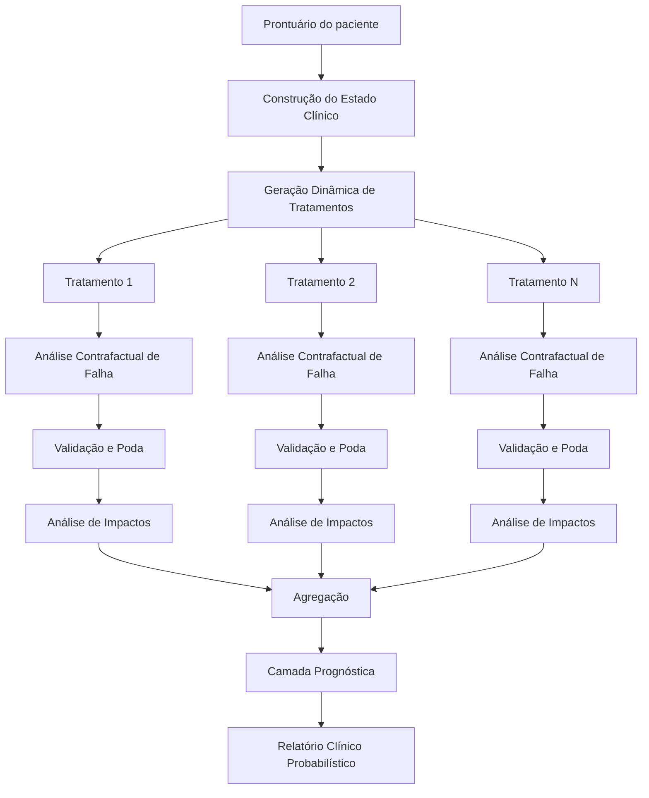
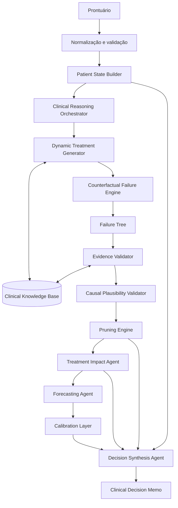
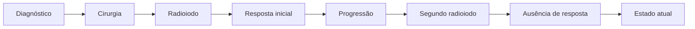

# Plano de Implementação — Sistema Multiagente de Prognóstico e Análise Terapêutica para Câncer de Tireoide

## 1. Visão Geral

O objetivo do projeto é desenvolver um sistema computacional de apoio à decisão clínica capaz de analisar o prontuário de um paciente com câncer de tireoide e identificar tratamentos potencialmente aplicáveis ao estado clínico e oncológico atual.

O sistema não terá como objetivo realizar o diagnóstico primário do câncer. O diagnóstico e as características básicas da neoplasia serão considerados informações previamente disponíveis no prontuário.

A tarefa central será:

> Dado o estado atual de um paciente com câncer de tireoide, quais estratégias terapêuticas são clinicamente plausíveis, como cada uma delas poderia falhar nesse paciente, quais consequências podem produzir e quais permanecem viáveis após uma análise contrafactual estruturada?

Para cada alternativa terapêutica identificada, o sistema assumirá contrafactualmente que o tratamento produziu um desfecho desfavorável e executará uma busca estruturada por mecanismos que possam explicar essa falha.

A análise deverá utilizar:

- características do tumor;
- estado clínico do paciente;
- tratamentos anteriores;
- resposta a tratamentos anteriores;
- comorbidades;
- exames laboratoriais;
- exames de imagem;
- perfil molecular;
- estado funcional;
- medicamentos em uso;
- toxicidades conhecidas;
- contraindicações;
- evidências clínicas recuperadas de fontes externas.

As hipóteses de falha que não forem compatíveis com o prontuário ou não apresentarem mecanismo clínico plausível deverão ser podadas.

A ausência de um mecanismo plausível de falha não será interpretada como prova de eficácia do tratamento. O tratamento será classificado apenas como:

> **candidato que permanece clinicamente plausível dentro das informações analisadas.**

---

# 2. Questão Central do Sistema

A entrada principal será:

```text
Prontuário estruturado de um paciente
com câncer de tireoide confirmado
```

A saída deverá responder cinco questões principais:

```text
1. Qual é o estado clínico e oncológico atual do paciente?

2. Quais tratamentos fazem sentido considerar neste estado?

3. Como cada tratamento poderia produzir um desfecho desfavorável?

4. Quais desses mecanismos realmente são plausíveis neste paciente?

5. Quais consequências cada tratamento pode produzir mesmo que seja eficaz?
```

A arquitetura pode ser resumida como:



---

# 3. Escopo Clínico Inicial

O domínio do sistema será inicialmente restrito a:

```text
Câncer de tireoide
```

O sistema deverá ser projetado para posteriormente representar diferentes tipos histológicos, mas a implementação inicial pode começar pelo câncer diferenciado de tireoide.

Uma estratégia de desenvolvimento progressiva seria:

```text
FASE 1
Carcinoma papilífero

↓

FASE 2
Carcinoma folicular
Carcinoma oncocítico

↓

FASE 3
Carcinoma medular

↓

FASE 4
Carcinoma pouco diferenciado
Carcinoma anaplásico
```

Essa expansão é importante porque diferentes tipos de câncer de tireoide apresentam:

- biologia distinta;
- marcadores distintos;
- tratamentos diferentes;
- padrões diferentes de progressão;
- respostas diferentes aos tratamentos;
- perfis moleculares diferentes.

---

# 4. O que o sistema NÃO deve fazer

O sistema não deverá:

- diagnosticar câncer de tireoide a partir de sintomas;
- substituir o oncologista;
- emitir uma prescrição médica;
- declarar categoricamente que determinado tratamento funcionará;
- interpretar ausência de falha encontrada como garantia de eficácia;
- inventar informações ausentes no prontuário;
- inferir automaticamente que ausência de informação significa resultado normal;
- produzir mecanismos clínicos sem evidência;
- ocultar incertezas.

A saída deve ser entendida como:

```text
Sistema de apoio à análise terapêutica e prognóstica
```

e não:

```text
Sistema autônomo de decisão médica
```

---

# 5. Princípio Fundamental da Arquitetura

A arquitetura deverá separar explicitamente quatro conceitos.

## 5.1 Elegibilidade terapêutica

Pergunta:

> Esse tratamento é aplicável ao estado atual do paciente?

---

## 5.2 Falha contrafactual

Pergunta:

> Suponha que esse tratamento foi realizado e produziu um desfecho desfavorável. Por que isso poderia ter acontecido?

---

## 5.3 Impacto do tratamento

Pergunta:

> Mesmo que o tratamento tenha sucesso oncológico, quais consequências ele pode produzir para este paciente?

---

## 5.4 Prognóstico

Pergunta:

> Considerando o estado atual, o tratamento e os mecanismos identificados, quais desfechos são plausíveis e com que grau de confiança?

Essas quatro tarefas não devem ser executadas por um único prompt.

---

# 6. Arquitetura Geral Proposta



---

# 7. Camada 1 — Entrada do Prontuário

O sistema deverá receber um prontuário estruturado em JSON.

O JSON deve preservar tanto:

```text
dados objetivos
```

quanto:

```text
descrições clínicas
```

Exemplo:

```json
{
  "hemoglobina_g_dl": 8.1,
  "interpretacao": "anemia importante"
}
```

em vez de armazenar apenas:

```json
{
  "anemia": true
}
```

O valor original é necessário para que outros componentes possam avaliar a gravidade do achado.

---

# 8. Validação do Prontuário

Antes de qualquer raciocínio, deverá existir um módulo chamado:

```text
Medical Record Validator
```

Responsabilidades:

- validar o JSON;
- detectar campos inconsistentes;
- detectar valores impossíveis;
- identificar informações ausentes;
- detectar conflitos temporais;
- normalizar unidades;
- verificar datas;
- organizar exames em ordem cronológica.

Exemplo:

```text
Creatinina:
2025 → 0.9
2026 → 1.1
2026 → 4.7
```

O sistema não deve reduzir tudo para:

```text
"função renal alterada"
```

A evolução temporal deve ser preservada.

---

# 9. Patient State Builder

O prontuário completo pode possuir centenas ou milhares de informações.

Não é desejável entregar tudo diretamente para cada agente.

Será criado um componente:

```text
Patient State Builder
```

Sua responsabilidade será construir uma representação clínica resumida, mas auditável.

Exemplo:

```json
{
  "patient_state": {
    "cancer": {
      "histology": "papillary_thyroid_carcinoma",
      "stage": "pT3b pN1b",
      "metastatic": true,
      "metastatic_sites": [
        "lungs"
      ],
      "iodine_avidity": "absent_in_pulmonary_lesions",
      "progression_status": "radiological_progression",
      "molecular_profile": {
        "BRAF_V600E": true
      }
    },

    "patient": {
      "age": 62,
      "ECOG": 1,

      "renal_function": "preserved",
      "hepatic_function": "preserved",

      "cardiovascular": {
        "hypertension": true,
        "controlled": true
      }
    },

    "previous_treatments": [
      "total_thyroidectomy",
      "radioiodine_therapy",
      "second_radioiodine_therapy"
    ],

    "active_problems": [
      "progressive pulmonary metastases",
      "rising thyroglobulin"
    ]
  }
}
```

---

# 10. Proveniência dos Dados

Cada informação resumida deve apontar para sua origem.

Exemplo:

```json
{
  "fact": "progressive_pulmonary_metastases",

  "evidence": [
    {
      "source": "CT_2025",
      "finding": "largest lesion 9 mm"
    },
    {
      "source": "CT_2026",
      "finding": "largest lesion 15 mm"
    }
  ]
}
```

Isso será fundamental para auditabilidade.

---

# 11. Clinical Reasoning Orchestrator

O sistema deverá possuir um agente coordenador.

Nome sugerido:

```text
Clinical Reasoning Orchestrator
```

ou:

```text
Chief Medical Reasoning Agent — CMRA
```

Responsabilidades:

1. receber o estado do paciente;
2. determinar quais agentes deverão ser acionados;
3. solicitar geração de tratamentos;
4. iniciar uma análise independente para cada tratamento;
5. controlar profundidade das árvores;
6. impedir loops;
7. controlar limite computacional;
8. reunir resultados;
9. detectar conflitos;
10. produzir o relatório final.

Importante:

O CMRA não deve realizar sozinho todo o raciocínio.

Ele é um:

```text
coordenador
```

e não o:

```text
especialista universal
```

---

# 12. Dynamic Treatment Generator

O primeiro componente de raciocínio será:

```text
Dynamic Treatment Generator
```

Ele deverá responder:

> Considerando exclusivamente o estado atual desse paciente, quais estratégias terapêuticas merecem ser analisadas?

Não deverá existir uma lista fixa do tipo:

```python
treatments = [
    "chemotherapy",
    "surgery",
    "radiotherapy",
    "immunotherapy"
]
```

A lista deverá ser produzida dinamicamente.

---

# 13. Variáveis consideradas na geração de tratamentos

O gerador deverá considerar pelo menos:

```text
Histologia
Subtipo histológico
Grau de diferenciação
TNM
Risco de recorrência
Carga tumoral
Localização da doença
Progressão
Velocidade de progressão
Sintomas
Radioiodo-avididade
Perfil molecular
Tratamentos anteriores
Resposta aos tratamentos
Toxicidades anteriores
Idade
ECOG
Comorbidades
Função renal
Função hepática
Estado cardiovascular
Medicamentos
Preferências disponíveis no prontuário
```

---

# 14. Representação de um tratamento candidato

Cada candidato deverá possuir um objeto próprio.

```json
{
  "treatment_id": "TX_001",

  "name": "Treatment X",

  "class": "systemic_therapy",

  "therapeutic_goal": "disease_control",

  "reason_for_consideration": [
    "progressive metastatic disease",
    "previous treatment failure"
  ],

  "patient_evidence": [
    "CT shows progression",
    "thyroglobulin increasing"
  ],

  "contraindications_detected": [],

  "evidence_source_ids": [
    "GUIDELINE_001"
  ],

  "status": "candidate"
}
```

---

# 15. Clinical Knowledge Base

O modelo não deverá depender apenas do conhecimento interno do LLM.

Será criada uma base de conhecimento clínico.

Ela poderá conter:

```text
guidelines
artigos científicos
documentos regulatórios
bulas
consensos
revisões sistemáticas
protocolos
```

O conhecimento deve ser versionado.

Exemplo:

```json
{
  "document_id": "GUIDELINE_001",
  "title": "...",
  "version": "...",
  "publication_date": "...",
  "sections": []
}
```

---

# 16. Retrieval-Augmented Generation — RAG

O sistema deverá recuperar evidências relacionadas a:

```text
tratamento
+
tipo de câncer
+
estado do paciente
+
possível toxicidade
+
mecanismo de falha
```

Exemplo de busca:

```text
papillary thyroid carcinoma
radioiodine refractory
pulmonary metastases
BRAF V600E
systemic treatment
```

O resultado recuperado será entregue aos agentes de raciocínio.

---

# 17. Início da Análise Contrafactual

Para cada tratamento candidato, será criada uma hipótese raiz.

Exemplo:

```text
Paciente recebeu o Tratamento X.

O tratamento produziu um desfecho desfavorável.

Explique mecanismos plausíveis que poderiam levar
a esse resultado especificamente neste paciente.
```

Essa será a raiz da árvore.

---

# 18. Definição de Falha

"Tratamento deu errado" é muito genérico.

O sistema deverá decompor falha em diferentes desfechos.

Exemplos:

```text
morte relacionada ao tratamento
progressão da doença
ausência de resposta
recorrência
toxicidade grave
interrupção do tratamento
redução de dose
hospitalização
deterioração funcional
perda significativa de qualidade de vida
complicação permanente
```

---

# 19. Failure Outcome Generator

Antes da árvore causal, deverá existir:

```text
Failure Outcome Generator
```

Para cada tratamento ele gera possíveis classes de falha.

Exemplo:

```text
Tratamento X

├── Falha oncológica
├── Toxicidade
├── Intolerância
├── Interrupção
├── Progressão
└── Mortalidade
```

---

# 20. Counterfactual Failure Tree

Cada resultado adverso será transformado em uma árvore independente.

Exemplo:

```text
Tratamento X falhou
│
├── Tumor não respondeu
│
│   ├── mecanismo molecular
│   ├── resistência pré-existente
│   └── progressão rápida
│
├── Paciente não tolerou
│
│   ├── função renal
│   ├── função hepática
│   ├── estado cardiovascular
│   └── estado hematológico
│
└── Toxicidade grave
    │
    ├── cardiovascular
    ├── hematológica
    └── metabólica
```

---

# 21. Estrutura de um nó da árvore

A árvore não deve armazenar "pensamentos livres".

Cada nó deverá ser estruturado.

```json
{
  "node_id": "N_001",

  "parent_id": "ROOT",

  "hypothesis": "Treatment failure due to severe hematologic toxicity",

  "mechanism": "Treatment can worsen pre-existing severe anemia",

  "required_patient_condition": "severe_anemia",

  "patient_evidence": [
    {
      "field": "hemoglobin",
      "value": 7.1,
      "unit": "g/dL"
    }
  ],

  "supporting_external_evidence": [
    "SOURCE_017"
  ],

  "contradictory_evidence": [],

  "clinical_plausibility": "high",

  "temporal_plausibility": "high",

  "patient_specificity": "high",

  "status": "active"
}
```

Isso cria um **raciocínio externo e auditável**, sem depender da cadeia interna de pensamento do LLM.

---

# 22. Expansão dos nós

Um nó somente poderá gerar filhos caso:

```text
1. não tenha sido podado;
2. ainda exista uma pergunta causal relevante;
3. a profundidade máxima não tenha sido atingida;
4. existam informações clínicas suficientes;
5. a hipótese tenha relevância para o desfecho.
```

Exemplo:

```text
Quimioterapia
↓
Toxicidade hematológica
↓
Anemia
↓
Paciente já possui anemia grave?
↓
Sim
↓
Tratamento pode piorar anemia?
↓
Sim
↓
Anemia pode levar a interrupção/redução?
↓
Sim
↓
Redução da exposição terapêutica
↓
Possível comprometimento da eficácia
```

---

# 23. Pruning Engine

A poda é uma das partes centrais do projeto.

Um nó deverá ser removido quando apresentar uma das seguintes condições.

## 23.1 Condição ausente

Hipótese:

```text
Falha devido a insuficiência renal grave
```

Prontuário:

```text
Creatinina: 0.8
eGFR: 92
```

Resultado:

```text
PRUNED_PATIENT_CONDITION_ABSENT
```

---

## 23.2 Mecanismo clinicamente não sustentado

```text
PRUNED_UNSUPPORTED_MECHANISM
```

---

## 23.3 Incompatibilidade temporal

Exemplo:

```text
Evento ocorreu antes da exposição ao tratamento.
```

Resultado:

```text
PRUNED_TEMPORAL_INCONSISTENCY
```

---

## 23.4 Hipótese não específica

Exemplo:

```text
"O tratamento pode falhar porque câncer é uma doença grave."
```

Resultado:

```text
PRUNED_NON_SPECIFIC
```

---

## 23.5 Contradição pelo prontuário

```text
PRUNED_CONTRADICTED_BY_RECORD
```

---

## 23.6 Evidência insuficiente

A hipótese não deve necessariamente ser removida.

Ela pode permanecer como:

```text
UNRESOLVED
```

Exemplo:

```text
Hipótese depende da fração de ejeção cardíaca,
mas o paciente não possui ecocardiograma recente.
```

Saída:

```json
{
  "status": "unresolved",
  "missing_information": "recent_ejection_fraction"
}
```

Isso é preferível a inventar um valor.

---

# 24. Evidence Validator

O agente:

```text
Evidence Validator
```

será responsável por verificar se a hipótese realmente possui suporte no prontuário.

Entrada:

```text
hipótese
+
estado clínico
```

Saída:

```json
{
  "supported": true,
  "supporting_evidence": [],
  "contradictory_evidence": [],
  "missing_information": []
}
```

---

# 25. Causal Plausibility Validator

Uma associação não deverá automaticamente ser considerada uma explicação causal.

Exemplo:

```text
Paciente tem hipertensão
+
tratamento falhou

≠

tratamento falhou por causa da hipertensão
```

Será necessário avaliar:

```text
Existe mecanismo conhecido?
Existe relação temporal?
A magnitude é relevante?
Existe evidência clínica?
O mecanismo leva ao desfecho analisado?
```

---

# 26. Representação causal

Uma cadeia válida deve ser representada aproximadamente como:

```text
Característica do paciente
        ↓
Interação com tratamento
        ↓
Alteração fisiológica
        ↓
Evento adverso / redução de eficácia
        ↓
Desfecho clínico
```

Exemplo abstrato:

```text
Hipertensão não controlada
        ↓
Tratamento pode elevar pressão arterial
        ↓
Hipertensão grave
        ↓
necessidade de interrupção/redução
        ↓
menor exposição ao tratamento
        ↓
possível redução do controle tumoral
```

---

# 27. Regras de parada da árvore

A expansão de uma árvore deverá parar quando ocorrer:

```text
mecanismo terminal identificado
OU
hipótese podada
OU
informação necessária ausente
OU
profundidade máxima
OU
ausência de novas hipóteses
OU
ganho informacional abaixo do limite
```

Para o MVP:

```text
profundidade máxima sugerida: 4 a 6
```

O valor deverá ser configurável.

---

# 28. Controle de explosão combinatória

Uma Tree of Thoughts sem controle pode crescer exponencialmente.

Será necessário utilizar:

```text
beam search
```

ou mecanismo semelhante.

Exemplo:

```text
cada nó gera até 5 hipóteses
↓
validator atribui relevância
↓
mantém apenas as 3 mais relevantes
```

Configuração:

```yaml
tree:
  max_depth: 5
  max_children_per_node: 5
  beam_width: 3
  minimum_plausibility: 0.60
```

---

# 29. Tratamentos Independentes

Cada tratamento deverá possuir uma árvore independente.

Não deve existir algo como:

```text
Tratamento A falhou
↓
então analisar Tratamento B
```

A arquitetura correta é:

```text
Paciente
│
├── Tratamento A
│   └── Failure Tree A
│
├── Tratamento B
│   └── Failure Tree B
│
└── Tratamento C
    └── Failure Tree C
```

Isso permite comparação posterior sem contaminação entre raciocínios.

---

# 30. Treatment Impact Agent

Após a análise de falha, cada tratamento será analisado por outro agente:

```text
Treatment Impact Agent
```

Pergunta:

> Independentemente de o tratamento controlar ou não o câncer, quais impactos ele pode produzir para este paciente?

---

# 31. Categorias de impacto

Os impactos deverão ser organizados em:

```text
curto prazo
médio prazo
longo prazo
permanente
reversível
irreversível
```

E também por domínio:

```text
oncológico
funcional
endócrino
cardiovascular
renal
hepático
hematológico
neurológico
reprodutivo
psicológico
nutricional
qualidade de vida
hospitalização
necessidade de monitoramento
uso crônico de medicamentos
```

---

# 32. Exemplo de impacto

```json
{
  "treatment": "surgery",

  "expected_impacts": [
    {
      "impact": "need_for_long_term_hormone_replacement",
      "probability_class": "expected",
      "duration": "permanent",
      "severity": "moderate",
      "patient_specific": true
    }
  ]
}
```

---

# 33. Separação entre impacto e falha

É fundamental não confundir:

```text
consequência esperada
```

com:

```text
falha do tratamento
```

Exemplo:

```text
necessidade de reposição hormonal
```

pode ser uma consequência esperada de determinada intervenção e não necessariamente uma falha.

---

# 34. Forecasting Agent

Após gerar:

```text
tratamento
+
árvore de falhas
+
impactos
+
evidências
```

entra a camada de prognóstico.

O agente deverá produzir probabilidades quando houver suporte metodológico para isso.

Exemplos:

```text
P(controle da doença | tratamento, paciente)
P(progressão | tratamento, horizonte)
P(toxicidade grave | tratamento, paciente)
P(interrupção | tratamento, paciente)
P(desfecho adverso | tratamento, paciente)
```

---

# 35. Horizonte temporal

Toda previsão deverá ter um horizonte.

Nunca:

```text
Risco de progressão = 40%
```

Preferir:

```text
Probabilidade de progressão em 12 meses = 40%
```

Os horizontes devem ser configuráveis:

```text
6 meses
12 meses
24 meses
5 anos
```

dependendo do problema.

---

# 36. Superforecasting

A camada de superforecasting pode utilizar múltiplas previsões independentes.

Exemplo:

```text
Forecaster A → 0.40
Forecaster B → 0.55
Forecaster C → 0.47
```

Depois:

```text
Aggregation Agent
```

combina as previsões.

Possíveis estratégias:

```text
média
mediana
média ponderada
ensemble
regressão logística
stacking
```

---

# 37. Calibration Layer

Probabilidades produzidas por LLMs não devem ser consideradas calibradas automaticamente.

Será criada uma camada específica:

```text
Calibration Agent
```

ou preferencialmente:

```text
modelo estatístico externo de calibração
```

Possíveis técnicas:

```text
Logistic Calibration
Platt Scaling
Isotonic Regression
Beta Calibration
```

---

# 38. Métricas probabilísticas

Para previsões com desfechos observáveis:

```text
Brier Score
Calibration Error
Calibration Curve
Log Loss
AUROC
AUPRC
```

Para o componente de superforecasting, Brier Score deverá ter papel importante.

---

# 39. Decision Synthesis Agent

O componente final:

```text
Decision Synthesis Agent
```

não deverá simplesmente escolher:

```text
MELHOR TRATAMENTO = X
```

Ele deverá organizar a evidência.

Exemplo:

```json
{
  "treatment": "Treatment X",

  "candidate_status": "remains_plausible",

  "supporting_factors": [],

  "failure_mechanisms": [],

  "pruned_failure_hypotheses": [],

  "unresolved_failure_hypotheses": [],

  "expected_impacts": [],

  "missing_information": [],

  "forecast": {},

  "uncertainty": {}
}
```

---

# 40. Estados possíveis de um tratamento

Sugestão:

```text
CANDIDATE
REMAINS_PLAUSIBLE
HIGH_RISK
CONTRAINDICATION_IDENTIFIED
INSUFFICIENT_INFORMATION
NOT_APPLICABLE
```

Evitar:

```text
APPROVED
SAFE
BEST
GUARANTEED
```

---

# 41. Clinical Decision Memo

O resultado final deverá ser legível tanto por humanos quanto por máquinas.

Exemplo:

```text
PATIENT STATE

Carcinoma papilífero metastático...
ECOG 1...
Função renal preservada...

------------------------------------------------

TREATMENT A

Por que foi considerado:
...

Mecanismos plausíveis de falha:
1...
2...

Hipóteses descartadas:
1...
2...

Impactos:
...

Incertezas:
...

Dados adicionais úteis:
...

------------------------------------------------

TREATMENT B
...
```

---

# 42. Saída estruturada

Além do relatório textual, deverá existir um JSON.

```json
{
  "case_id": "CASE_001",

  "patient_state": {},

  "candidate_treatments": [
    {
      "treatment_id": "TX001",

      "status": "remains_plausible",

      "failure_analysis": {
        "active_paths": [],
        "pruned_paths": [],
        "unresolved_paths": []
      },

      "impact_analysis": [],

      "forecast": {},

      "uncertainties": []
    }
  ]
}
```

---

# 43. Arquitetura de Agentes — MVP

Para evitar complexidade prematura, a primeira versão deverá possuir poucos agentes.

## Agente 1 — Patient State Agent

Responsável por resumir o prontuário.

---

## Agente 2 — Treatment Generator

Responsável por produzir candidatos terapêuticos.

---

## Agente 3 — Failure Hypothesis Generator

Responsável por expandir a árvore.

---

## Agente 4 — Evidence Validator

Responsável por validar cada hipótese contra prontuário e base externa.

---

## Agente 5 — Impact Agent

Responsável por consequências terapêuticas.

---

## Agente 6 — Synthesis Agent

Responsável pela saída final.

---

# 44. Arquitetura Avançada

Posteriormente:

```text
CMRA
│
├── Patient State Agent
│
├── Treatment Generator
│
├── Oncology Specialist
│
├── Endocrinology Specialist
│
├── Molecular Oncology Specialist
│
├── Surgical Specialist
│
├── Pharmacology Specialist
│
├── Failure Generator
│
├── Evidence Validator
│
├── Causal Validator
│
├── Impact Agent
│
├── Forecasting Agents
│
├── Calibration Agent
│
└── Synthesis Agent
```

---

# 45. Evitar excesso de agentes

Não criar um agente simplesmente porque existe uma especialidade médica.

Um novo agente somente deverá ser criado se:

```text
produzir informação diferente
OU
realizar uma função metodologicamente diferente
OU
aumentar desempenho mensurável
```

Caso contrário, aumenta apenas:

```text
custo
latência
complexidade
variabilidade
```

---

# 46. Orquestração

Recomenda-se representar o workflow como uma máquina de estados explícita.

Exemplo:

```python
INGEST
↓
BUILD_STATE
↓
GENERATE_TREATMENTS
↓
FOR_EACH_TREATMENT
    GENERATE_FAILURE_OUTCOMES
    BUILD_TREE
    VALIDATE
    PRUNE
    ANALYZE_IMPACTS
    FORECAST
↓
AGGREGATE
↓
REPORT
```

Um framework de agentes pode ser utilizado, mas a lógica principal deve permanecer independente do framework.

---

# 47. Organização sugerida do repositório

```text
thyroid-prognosis-system/
│
├── README.md
│
├── pyproject.toml
│
├── docker-compose.yml
│
├── .env.example
│
│
├── configs/
│   ├── models.yaml
│   ├── agents.yaml
│   ├── tree.yaml
│   └── evaluation.yaml
│
├── data/
│   ├── synthetic_cases/
│   ├── raw/
│   ├── processed/
│   └── guidelines/
│
├── schemas/
│   ├── medical_record.py
│   ├── patient_state.py
│   ├── treatment.py
│   ├── tree_node.py
│   ├── forecast.py
│   └── report.py
│
├── src/
│   │
│   ├── ingestion/
│   │   ├── validator.py
│   │   ├── normalizer.py
│   │   └── timeline.py
│   │
│   ├── patient_state/
│   │   ├── builder.py
│   │   └── extractor.py
│   │
│   ├── knowledge/
│   │   ├── retriever.py
│   │   ├── indexer.py
│   │   └── citations.py
│   │
│   ├── treatments/
│   │   ├── generator.py
│   │   └── eligibility.py
│   │
│   ├── counterfactual/
│   │   ├── tree.py
│   │   ├── generator.py
│   │   ├── validator.py
│   │   ├── causal.py
│   │   └── pruning.py
│   │
│   ├── impacts/
│   │   └── analyzer.py
│   │
│   ├── forecasting/
│   │   ├── forecaster.py
│   │   ├── ensemble.py
│   │   └── calibration.py
│   │
│   ├── agents/
│   │   ├── base.py
│   │   ├── state_agent.py
│   │   ├── treatment_agent.py
│   │   ├── failure_agent.py
│   │   ├── validator_agent.py
│   │   ├── impact_agent.py
│   │   └── synthesis_agent.py
│   │
│   ├── orchestration/
│   │   ├── workflow.py
│   │   └── state.py
│   │
│   └── api/
│       └── main.py
│
├── prompts/
│   ├── patient_state.md
│   ├── treatment_generation.md
│   ├── failure_generation.md
│   ├── evidence_validation.md
│   ├── impact_analysis.md
│   └── synthesis.md
│
├── evaluation/
│   ├── gold_cases/
│   ├── metrics/
│   ├── experiments/
│   └── reports/
│
└── tests/
    ├── unit/
    ├── integration/
    └── clinical_cases/
```

---

# 48. Modelos de dados

Recomenda-se utilizar modelos fortemente tipados.

Exemplo conceitual:

```python
class TreeNode:
    id: str
    parent_id: str | None

    hypothesis: str
    mechanism: str

    patient_evidence: list
    external_evidence: list
    contradictory_evidence: list

    plausibility: float

    status: str
```

Pydantic pode ser utilizado para validação.

---

# 49. Interface comum para LLMs

Criar abstração:

```python
class LLMProvider:

    def generate(
        self,
        system_prompt,
        user_prompt,
        response_schema
    ):
        ...
```

Isso permitirá comparar diferentes modelos sem alterar a arquitetura.

---

# 50. Structured Outputs

Todos os agentes deverão responder preferencialmente em JSON validável.

Nunca depender exclusivamente de texto livre.

Fluxo:

```text
LLM
↓
JSON
↓
Schema validation
↓
Retry se inválido
↓
Persistência
```

---

# 51. Persistência

Inicialmente, o sistema pode armazenar:

```text
prontuários
patient states
árvores
tratamentos
resultados
experimentos
```

em banco documental ou relacional com suporte a JSON.

Também será útil manter um banco vetorial para recuperação de evidências.

---

# 52. Identificador de Experimento

Cada execução deverá registrar:

```text
experiment_id
case_id
model
model_version
temperature
prompt_version
knowledge_base_version
tree_configuration
timestamp
seed
```

Isso é essencial para reprodutibilidade científica.

---

# 53. Logs de raciocínio estruturado

Não armazenar apenas a resposta final.

Registrar:

```text
tratamentos gerados
nós criados
nós podados
razões de poda
evidências recuperadas
agentes executados
probabilidades
custos
latência
```

---

# 54. API

Endpoints iniciais:

```text
POST /cases
```

Recebe prontuário.

```text
POST /cases/{id}/analyze
```

Executa pipeline.

```text
GET /cases/{id}/patient-state
```

Retorna estado estruturado.

```text
GET /cases/{id}/treatments
```

Retorna tratamentos candidatos.

```text
GET /cases/{id}/treatments/{treatment_id}/tree
```

Retorna árvore contrafactual.

```text
GET /cases/{id}/report
```

Retorna análise completa.

---

# 55. Visualização da árvore

Uma interface de pesquisa deverá permitir visualizar:

```text
ROOT
│
├── H1 ✓
│   ├── H1.1 ✓
│   └── H1.2 ✗ PRUNED
│
├── H2 ✗ PRUNED
│
└── H3 ?
    └── MISSING DATA
```

Cada nó deverá mostrar:

```text
hipótese
mecanismo
evidência do paciente
evidência externa
status
razão da poda
confiança
```

---

# 56. Dados sintéticos

Antes de utilizar dados reais, criar uma base de casos sintéticos.

Casos mínimos:

```text
Caso 1 — doença localizada

Caso 2 — recorrência cervical

Caso 3 — doença metastática pulmonar

Caso 4 — doença radioiodo-refratária

Caso 5 — paciente com insuficiência renal

Caso 6 — paciente com doença cardiovascular

Caso 7 — paciente com anemia importante

Caso 8 — mutação molecular acionável

Caso 9 — baixa performance status

Caso 10 — múltiplas comorbidades
```

Cada caso deverá possuir um comportamento esperado.

---

# 57. Gold Standard

Para avaliação científica, idealmente especialistas deverão revisar casos.

Para cada paciente:

```text
tratamentos plausíveis
tratamentos não plausíveis
riscos relevantes
contraindicações
mecanismos possíveis de falha
impactos esperados
dados ausentes importantes
```

Isso formará:

```text
Clinical Gold Set
```

---

# 58. Avaliação — Treatment Generation

Avaliar:

```text
Recall de tratamentos relevantes
Precision
F1
Tratamentos irrelevantes gerados
Tratamentos importantes omitidos
```

Um erro particularmente importante será:

```text
missing clinically relevant treatment
```

---

# 59. Avaliação — Failure Tree

Para cada ramo:

```text
clinicamente plausível?
aplicável ao paciente?
possui suporte?
é causalmente coerente?
é redundante?
deveria ter sido podado?
```

Métricas:

```text
Branch Precision
Branch Recall
Pruning Precision
Pruning Recall
Unsupported Branch Rate
```

---

# 60. Hallucination Rate

Medir:

```text
Número de afirmações clínicas sem suporte
-----------------------------------------
Número total de afirmações clínicas
```

Separar:

```text
hallucination_patient_record
hallucination_medical_knowledge
hallucination_causal
```

---

# 61. Grounding Score

Cada afirmação importante deve estar associada a:

```text
prontuário
OU
fonte externa
OU
ambos
```

Pode-se definir:

```text
Grounded Claims / Total Claims
```

---

# 62. Avaliação de Prognóstico

Quando existirem probabilidades e desfechos conhecidos:

```text
Brier Score
Calibration Curve
ECE
Log Loss
AUROC
```

A calibração deve ser avaliada separadamente da discriminação.

---

# 63. Avaliação qualitativa

Especialistas podem atribuir:

```text
1 — incorreto
2 — majoritariamente incorreto
3 — parcialmente correto
4 — correto
5 — altamente útil
```

para:

```text
relevância
coerência
completude
segurança
utilidade clínica
auditabilidade
```

---

# 64. Baselines

O trabalho precisa comparar a arquitetura completa com alternativas mais simples.

## Baseline 1

LLM recebe prontuário e responde:

```text
Quais tratamentos são adequados?
```

---

## Baseline 2

LLM gera tratamentos + impactos.

Sem contrafactual.

---

## Baseline 3

LLM gera Tree of Thoughts.

Sem poda.

---

## Baseline 4

Tree + poda.

Sem recuperação externa.

---

## Sistema completo

```text
Patient State
+
Treatment Generator
+
RAG
+
Counterfactual Tree
+
Evidence Validation
+
Causal Validation
+
Pruning
+
Impact Analysis
+
Forecasting
+
Calibration
```

---

# 65. Ablation Studies

Executar experimentos removendo componentes.

### Sem Patient State Builder

Medir impacto de usar prontuário bruto.

### Sem RAG

Medir aumento de alucinação.

### Sem Counterfactual

Medir qualidade da análise de risco.

### Sem pruning

Medir quantidade de hipóteses falsas.

### Sem causal validator

Medir associações espúrias.

### Sem multiagentes

Comparar com único agente.

### Sem calibration

Comparar Brier e calibração.

---

# 66. Experimento particularmente importante

Comparar:

```text
"Por que esse tratamento pode falhar?"
```

versus:

```text
"Suponha que esse tratamento falhou.
Construa hipóteses e tente refutá-las
usando o prontuário."
```

Isso pode fornecer evidência direta sobre o valor do mecanismo contrafactual.

---

# 67. Controle de viés de confirmação

Existe um risco importante.

Ao dizer:

```text
"assuma que o tratamento falhou"
```

o modelo pode tentar inventar uma explicação mesmo que nenhuma seja plausível.

Por isso deverá existir explicitamente:

```text
NULL FAILURE HYPOTHESIS
```

ou:

```text
NO_SUPPORTED_FAILURE_MECHANISM_FOUND
```

O agente precisa ter permissão para concluir:

> Nenhum mecanismo específico suficientemente sustentado foi identificado com os dados disponíveis.

---

# 68. Contrafactual negativo

O sistema também pode executar:

```text
Tente refutar a hipótese de falha.
```

Isso produz uma dinâmica interessante:

```text
Failure Generator
        ↓
gera hipótese
        ↓
Evidence Validator
        ↓
tenta sustentá-la
        ↓
Critic Agent
        ↓
tenta refutá-la
        ↓
Pruning Decision
```

---

# 69. Debate entre agentes

Em uma versão avançada:

```text
Failure Agent:
"Anemia pode levar à falha."

Validator:
"Paciente possui Hb 12.8."

Critic:
"Logo, anemia pré-existente não explica a falha."

CMRA:
"Prune branch."
```

Esse padrão pode melhorar auditabilidade.

---

# 70. Critério formal de poda

Uma função conceitual pode ser definida:

```text
Keep(node) =
PatientEvidence
AND
ClinicalMechanism
AND
TemporalConsistency
AND
OutcomeRelevance
```

Se qualquer requisito essencial não for atendido:

```text
PRUNE
```

Se houver ausência de dados:

```text
UNRESOLVED
```

---

# 71. Score interno de plausibilidade

Para ordenar ramos:

```text
Plausibility =
w1 × patient_evidence
+
w2 × clinical_evidence
+
w3 × causal_coherence
+
w4 × temporal_consistency
+
w5 × outcome_relevance
```

Esse score deve ser usado inicialmente apenas para priorização da busca.

Não deve ser interpretado como probabilidade clínica real.

---

# 72. Diferenciar confiança e probabilidade

Nunca confundir:

```text
confidence_in_reasoning
```

com:

```text
probability_of_outcome
```

Exemplo:

```json
{
  "probability_of_toxicity": 0.30,
  "confidence_in_estimate": "low"
}
```

São conceitos diferentes.

---

# 73. Incerteza

Toda análise deverá produzir:

```text
incerteza epistemológica
```

e:

```text
incerteza por falta de dados
```

Exemplo:

```json
{
  "uncertainty": {
    "missing_data": [
      "recent echocardiogram"
    ],

    "conflicting_evidence": [],

    "limited_external_evidence": true
  }
}
```

---

# 74. Missing Data Agent

Opcionalmente, criar um agente capaz de responder:

> Quais informações adicionais seriam mais úteis para reduzir a incerteza desta decisão?

Exemplo:

```text
Ecocardiograma
Proteinúria
Novo exame de imagem
Teste molecular
```

Isso transforma o sistema também em suporte à investigação clínica.

---

# 75. Segurança contra inferência

Regra:

```text
MISSING != NORMAL
```

Se não houver creatinina:

Errado:

```text
função renal normal
```

Correto:

```text
função renal desconhecida
```

---

# 76. Temporal Reasoning

O sistema deverá compreender cronologia.

Exemplo:

```text
2024
Tratamento A

2025
Progressão

2026
Tratamento B
```

Não deve atribuir ao tratamento B um evento ocorrido em 2025.

Cada evento deverá possuir:

```text
timestamp
```

ou intervalo temporal.

---

# 77. Treatment History Graph

Pode ser representado:



Essa estrutura será útil para raciocínio.

---

# 78. Estado atual vs histórico

Nunca misturar:

```text
o paciente já teve anemia
```

com:

```text
o paciente atualmente possui anemia
```

O Patient State Builder deve diferenciar:

```text
active
resolved
historical
unknown
```

---

# 79. Implementação da primeira versão

A primeira versão deve ser propositalmente simples.

### Entrada

Um JSON sintético.

### Modelo

Um único LLM.

### Conhecimento

Pequeno conjunto de documentos.

### Tratamentos

Gerados dinamicamente.

### Árvore

Máximo 4 níveis.

### Validação

Segundo prompt independente.

### Poda

Regras simples.

### Saída

JSON + Markdown.

---

# 80. MVP — Pipeline

```text
medical_record.json
        ↓
PatientStateBuilder
        ↓
patient_state.json
        ↓
TreatmentGenerator
        ↓
treatments.json
        ↓
FOR treatment
        ↓
FailureGenerator
        ↓
FailureTree
        ↓
EvidenceValidator
        ↓
Pruner
        ↓
ImpactAnalyzer
        ↓
treatment_analysis.json
        ↓
Synthesis
        ↓
report.md
```

---

# 81. Critérios de aceite do MVP

O MVP estará funcional quando conseguir:

1. ler um prontuário JSON;
2. validar o schema;
3. construir o estado do paciente;
4. gerar ao menos uma lista dinâmica de tratamentos;
5. justificar por que cada tratamento foi considerado;
6. criar uma árvore contrafactual independente;
7. associar hipóteses a evidências do prontuário;
8. podar hipóteses contraditórias;
9. marcar hipóteses sem dados como incertas;
10. produzir impactos;
11. gerar relatório estruturado;
12. salvar todo o processo para auditoria.

---

# 82. Fase 1 — Modelagem

### Objetivo

Definir contratos antes dos agentes.

Implementar:

```text
MedicalRecord
PatientState
TreatmentCandidate
TreeNode
FailureOutcome
Impact
Forecast
AnalysisReport
```

### Entregável

```text
schemas/
```

com testes unitários.

---

# 83. Fase 2 — Patient State

Implementar:

```text
MedicalRecordValidator
TimelineBuilder
PatientStateBuilder
```

Testar com aproximadamente 10 casos sintéticos.

Critério:

O estado resumido deve preservar todos os fatores clinicamente importantes.

---

# 84. Fase 3 — Geração de Tratamentos

Implementar Treatment Generator.

Entrada:

```text
PatientState
```

Saída:

```text
List[TreatmentCandidate]
```

Critério:

Todo tratamento deve possuir:

```text
nome
classe
objetivo
justificativa
evidência
```

---

# 85. Fase 4 — Counterfactual Engine

Criar:

```text
FailureOutcomeGenerator
FailureHypothesisGenerator
TreeManager
```

Implementar:

```text
BFS/beam search
controle de profundidade
controle de duplicatas
```

---

# 86. Fase 5 — Evidence Validation

Criar validator independente.

Não reutilizar exatamente o mesmo prompt gerador.

Idealmente:

```text
Generator Model
≠
Validator Context
```

mesmo que inicialmente usem o mesmo modelo.

---

# 87. Fase 6 — Pruning

Implementar códigos formais:

```text
SUPPORTED
PRUNED_CONTRADICTION
PRUNED_ABSENT_CONDITION
PRUNED_UNSUPPORTED_MECHANISM
PRUNED_TEMPORAL
PRUNED_NON_SPECIFIC
UNRESOLVED_MISSING_DATA
```

---

# 88. Fase 7 — Impact Analysis

Criar Treatment Impact Agent.

Separar:

```text
expected effects
adverse effects
permanent consequences
monitoring burden
quality-of-life effects
```

---

# 89. Fase 8 — RAG

Adicionar base de documentos.

Pipeline:

```text
Document
↓
Parser
↓
Chunking
↓
Embedding
↓
Vector Store
↓
Retriever
```

Cada evidência utilizada precisa ser rastreável.

---

# 90. Fase 9 — Forecasting

Inicialmente, não tentar calibrar probabilidades sem dados.

Primeira versão:

```text
qualitative forecast
```

Posteriormente:

```text
numeric probability
```

Quando houver dataset de validação, aplicar calibração.

---

# 91. Fase 10 — Avaliação

Construir conjunto de casos avaliados por especialistas.

Executar:

```text
baseline
full system
ablations
```

---

# 92. Roadmap sugerido

## Etapa 1 — Fundação

Semanas 1–2:

```text
schema
casos sintéticos
validator
patient state
```

---

## Etapa 2 — Tratamentos

Semanas 3–4:

```text
Treatment Generator
knowledge base inicial
structured outputs
```

---

## Etapa 3 — Contrafactual

Semanas 5–7:

```text
Failure Generator
Tree Engine
Evidence Validator
Pruning
```

---

## Etapa 4 — Impacto

Semanas 8–9:

```text
Treatment Impact
Missing Data Analysis
Synthesis
```

---

## Etapa 5 — Evidência

Semanas 10–11:

```text
RAG
citation tracking
grounding
```

---

## Etapa 6 — Avaliação

Semanas 12–14:

```text
gold set
baselines
ablations
metrics
```

---

## Etapa 7 — Prognóstico probabilístico

Etapas posteriores:

```text
forecasting
ensemble
calibration
Brier score
calibration curves
```

---

# 93. Ordem ideal de implementação

Não começar pelos agentes.

A ordem recomendada é:

```text
1. Definir prontuário
2. Definir Patient State
3. Definir TreatmentCandidate
4. Definir TreeNode
5. Definir saída final
6. Criar casos sintéticos
7. Implementar pipeline determinístico
8. Inserir LLMs
9. Inserir RAG
10. Inserir multiagentes
11. Inserir forecasting
12. Inserir calibração
```

Isso reduz significativamente o risco de construir um sistema difícil de avaliar.

---

# 94. Primeira prova de conceito

A primeira POC deverá usar apenas:

```text
1 paciente
+
1 tipo de câncer
+
3–5 tratamentos candidatos
+
árvore com profundidade 3
```

O objetivo da POC não será desempenho.

Será verificar se o seguinte ciclo funciona:

```text
gera hipótese
↓
busca evidência
↓
testa hipótese
↓
poda
↓
expande
```

---

# 95. Primeiro experimento recomendado

Paciente fictício:

```text
Carcinoma papilífero
Metástases pulmonares
Progressão
BRAF V600E
ECOG 1
Hipertensão controlada
Função renal preservada
```

Executar geração de tratamentos.

Para cada tratamento:

```text
assumir falha
↓
gerar 5 mecanismos
↓
validar contra prontuário
↓
podar
↓
expandir sobreviventes
```

Esse caso pode ser o primeiro teste de ponta a ponta.

---

# 96. Exemplo do ciclo central

```python
for treatment in candidate_treatments:

    root = create_failure_root(treatment)

    tree = Tree(root)

    for depth in range(MAX_DEPTH):

        active_nodes = tree.active_nodes()

        for node in active_nodes:

            hypotheses = generate_failure_hypotheses(
                patient_state,
                treatment,
                node
            )

            for hypothesis in hypotheses:

                evidence = validate_against_patient(
                    patient_state,
                    hypothesis
                )

                clinical_evidence = retrieve_external_evidence(
                    hypothesis
                )

                decision = pruning_engine(
                    hypothesis,
                    evidence,
                    clinical_evidence
                )

                tree.add(
                    hypothesis,
                    decision
                )

    analyze_impacts(treatment)

    save(tree)
```

---

# 97. Invariante principal do sistema

Nenhum mecanismo poderá aparecer no resultado final sem:

```text
uma afirmação
+
uma evidência
+
uma ligação causal explícita
```

Formalmente:

```text
CLAIM
↓
EVIDENCE
↓
MECHANISM
↓
OUTCOME
```

---

# 98. Exemplo incorreto

```text
A hipertensão pode fazer o tratamento falhar.
```

---

# 99. Exemplo desejado

```text
O paciente possui hipertensão arterial.

O tratamento pode elevar a pressão arterial.

A elevação pode produzir hipertensão clinicamente significativa.

Hipertensão grave pode exigir redução ou suspensão do tratamento.

Uma redução da exposição pode comprometer o controle tumoral.

Portanto, existe um caminho plausível de falha relacionado ao estado cardiovascular do paciente.
```

A conclusão deverá indicar também o grau de incerteza.

---

# 100. Hipótese central de pesquisa

Uma possível hipótese de pesquisa seria:

> A utilização de raciocínio contrafactual estruturado, combinado com validação baseada em evidências e poda de hipóteses, produz análises terapêuticas mais relevantes, auditáveis e clinicamente fundamentadas do que respostas diretas produzidas por um único modelo de linguagem.

---

# 101. Hipóteses secundárias

### H1

A poda reduz mecanismos de falha falsos ou não aplicáveis.

### H2

RAG reduz afirmações clínicas não fundamentadas.

### H3

A representação estruturada do estado do paciente melhora a especificidade das análises.

### H4

Agentes independentes de geração e validação reduzem viés de confirmação.

### H5

A agregação de múltiplas previsões melhora calibração prognóstica.

---

# 102. Possíveis contribuições científicas

O trabalho poderá contribuir com:

```text
1. Arquitetura multiagente especializada em decisão terapêutica.

2. Estratégia de análise contrafactual de falha.

3. Representação explícita de Failure Trees.

4. Estratégia de pruning baseada no prontuário.

5. Separação entre falha terapêutica e impacto no paciente.

6. Integração entre reasoning, evidência e prognóstico probabilístico.

7. Pipeline auditável para câncer de tireoide.

8. Dataset sintético/curado de casos para avaliação.

9. Métricas específicas para qualidade de árvores clínicas.

10. Estudo de ablação dos componentes.
```

---

# 103. Principal diferencial conceitual

O sistema não pergunta apenas:

> Qual tratamento você recomenda?

Ele pergunta:

> Quais tratamentos são plausíveis?

Depois:

> Suponha que cada um deles deu errado.

Depois:

> Quais mecanismos poderiam explicar essa falha?

Depois:

> Esses mecanismos realmente existem neste paciente?

Depois:

> Quais hipóteses devem ser descartadas?

Depois:

> Quais riscos permanecem?

Depois:

> Quais consequências esse tratamento produziria mesmo caso funcionasse?

Essa sequência constitui o núcleo metodológico do projeto.

---

# 104. Resultado esperado

A saída final deve permitir que um profissional visualize algo como:

```text
Paciente
│
├── Tratamento A
│   │
│   ├── Motivos para considerar
│   │
│   ├── Falhas plausíveis
│   │
│   ├── Falhas descartadas
│   │
│   ├── Impactos
│   │
│   ├── Incertezas
│   │
│   └── Prognóstico
│
├── Tratamento B
│   └── ...
│
└── Tratamento C
    └── ...
```

O objetivo final não é produzir uma decisão automática, mas fornecer uma representação estruturada, explicável e probabilística das alternativas terapêuticas disponíveis para aquele paciente.

---

# 105. Próximo passo de implementação

O próximo passo recomendado é não começar pelos prompts nem pela implementação dos agentes.

Deve-se primeiro definir formalmente quatro schemas:

```text
MedicalRecord
PatientState
TreatmentCandidate
CounterfactualTree
```

Em seguida deve ser construído um único caso clínico sintético completo e uma saída esperada revisada manualmente.

Somente depois disso deverá ser implementado o primeiro pipeline com LLM.

Isso permitirá que cada agente seja desenvolvido contra um contrato claro e que a qualidade da arquitetura possa ser medida desde a primeira versão.