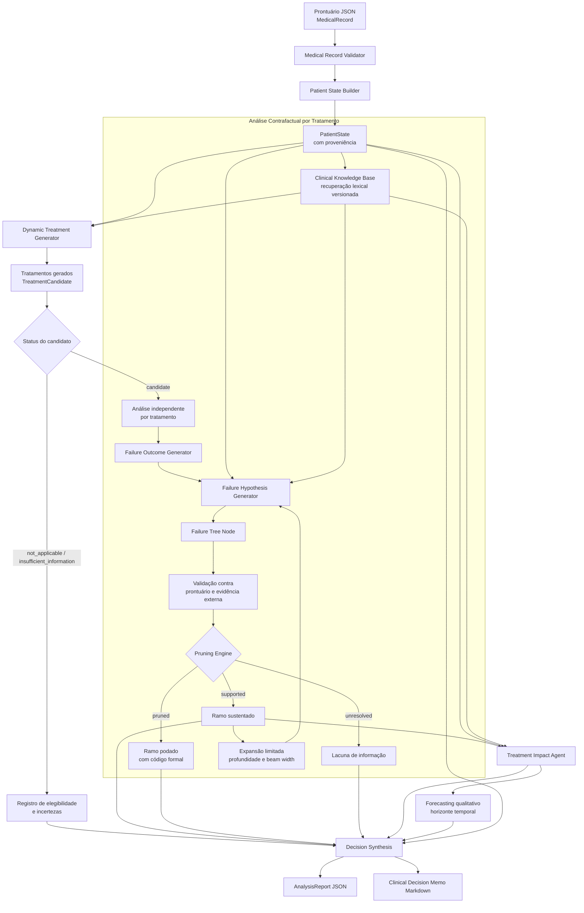

# Sistema Multiagente de Prognóstico para Câncer de Tireoide

MVP auditável de apoio à análise terapêutica para câncer de tireoide confirmado. O sistema não diagnostica, não prescreve e não seleciona automaticamente um tratamento.

## Pipeline

```text
MedicalRecord JSON
  -> MedicalRecordValidator
  -> PatientStateBuilder com proveniência
  -> Treatment Generator
  -> árvore contrafactual independente por tratamento
  -> validação e poda formal
  -> Treatment Impact Agent
  -> prognóstico qualitativo
  -> relatório JSON + Markdown
```

## Arquitetura



Os candidatos são dinâmicos. Uma hipótese de falha somente permanece na árvore quando contém condição do paciente, cadeia causal explícita, evidência do prontuário e suporte da base externa recuperada. Ausência de dados resulta em `UNRESOLVED_MISSING_DATA`; não é tratada como normalidade. A ausência de mecanismo suportado não demonstra eficácia.

## Componentes

- `src/prognostico/record.py`: validação de datas, cronologia e conflitos temporais.
- `src/prognostico/state.py`: estado clínico resumido com evidências de origem.
- `src/prognostico/knowledge.py`: recuperação versionada de documentos clínicos.
- `src/prognostico/thyroid_pipeline.py`: geração de candidatos, árvore, poda, impacto e relatório estruturado.
- `data/guidelines/thyroid_poc.json`: base documental demonstrativa e versionada do MVP.
- `examples/caso_prognostico.json`: caso sintético de carcinoma papilífero metastático.

## Uso

Instale o Qwen no Ollama:

```bash
ollama pull qwen2.5:7b
```

Execute a análise:

```bash
PYTHONPATH=src python3 -m prognostico.cli examples/caso_prognostico.json --out outputs/thyroid_report.json
```

O comando grava `outputs/thyroid_report.json` e `outputs/thyroid_report.md` usando o modelo configurado no Ollama.

## Limites do MVP

- O escopo inicial é carcinoma diferenciado de tireoide, com caso sintético.
- A previsão é qualitativa em horizonte de 12 meses. Não há probabilidade numérica nem calibração sem conjunto de validação.
- A recuperação atual é lexical e usa documentos demonstrativos; ela deve ser substituída por RAG validado e fontes clínicas versionadas antes de qualquer uso de pesquisa ou clínico.

## Testes

```bash
pytest
```

Os testes cobrem validação, proveniência do estado, geração dinâmica, árvores independentes e poda de condição ausente.
