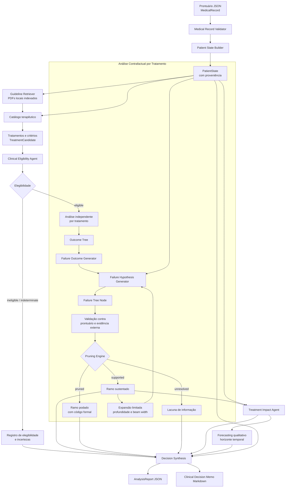

# Sistema Multiagente de Prognóstico para Câncer de Tireoide

MVP auditável de apoio à análise terapêutica para câncer de tireoide confirmado. O sistema não diagnostica, não prescreve e não seleciona automaticamente um tratamento.

## Pipeline

```text
MedicalRecord JSON
  -> MedicalRecordValidator
  -> PatientStateBuilder com proveniência + grafo de conhecimento factual
  -> catálogo terapêutico + recuperação local de diretrizes
  -> avaliação determinística de elegibilidade
  -> árvore causal por tratamento: diagnóstico -> condição contrafactual -> manifestação -> desfecho
  -> validação e poda formal
  -> Treatment Impact Agent
  -> prognóstico qualitativo
  -> relatório JSON + Markdown
```

## Arquitetura



O grafo contém exclusivamente fatos estruturados e sua proveniência; hipóteses do modelo vivem apenas na árvore causal. O diagnóstico de câncer de tireoide confirmado é a raiz de toda análise. Para cada tratamento, o sistema só gera o desfecho após expandir uma condição contrafactual e sua manifestação clínica. Uma folha sem fatos válidos, suporte externo ou plausibilidade suficiente não avança. Ausência de dados não é tratada como normalidade.

## Componentes

- `src/prognostico/record.py`: validação de datas, cronologia e conflitos temporais.
- `src/prognostico/state.py`: estado clínico resumido com evidências de origem.
- `src/prognostico/knowledge_graph.py`: grafo factual e temporal do prontuário.
- `src/prognostico/treatment_catalog.py`: catálogo versionado e critérios explícitos de aplicabilidade.
- `src/prognostico/eligibility.py`: decisão determinística de elegibilidade antes da expansão das árvores.
- `src/prognostico/guidelines.py`: ingestão de PDFs, indexação com página e recuperação local citável.
- `src/prognostico/thyroid_pipeline.py`: árvores, poda, impacto e relatório estruturado.
- `examples/caso_prognostico.json`: caso sintético de carcinoma papilífero metastático.

## Uso

Instale o modelo configurado no Ollama:

```bash
ollama pull qwen3.5:9b
```

Indexe as diretrizes locais após atualizar os PDFs em `guidelines/`:

```bash
PYTHONPATH=src python3 -m prognostico.guideline_ingest guidelines
```

Execute a análise:

```bash
PYTHONPATH=src python3 -m prognostico.cli examples/caso_prognostico.json --guideline-index guidelines/processed/index.json --out outputs/thyroid_report.json
```

O comando grava `outputs/thyroid_report.json` e `outputs/thyroid_report.md` usando o modelo configurado no Ollama.

## Limites do MVP

- O escopo inicial é carcinoma diferenciado de tireoide, com caso sintético.
- A previsão é qualitativa em horizonte de 12 meses. Não há probabilidade numérica nem calibração sem conjunto de validação.
- As diretrizes recuperadas são trechos locais com identificação de documento e página; elas não substituem avaliação por especialista ou validação clínica.

## Testes

```bash
pytest
```

Os testes cobrem validação, proveniência do estado, recuperação de diretrizes, elegibilidade do catálogo, árvores independentes e poda de condição ausente.
